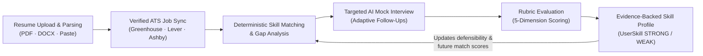

# TrueHire

**TrueHire** is an evidence-based interview-readiness platform for software engineers. It parses resumes into structured skill profiles, syncs active engineering roles from public ATS boards, scores role fit deterministically against a canonical skill ontology, runs adaptive AI mock interviews, and writes verified rubric evidence back into the candidate's profile.

---

## Product Preview


| Deterministic Job Match | Skill Gap & What-If Simulator |
| :---: | :---: |
|  |  |

| Resume Intelligence | Evidence-Bounded Tailoring |
| :---: | :---: |
|  |  |

---

## The Closed-Loop Workflow

Most career tools isolate resume editing, job browsing, and mock interviews into separate workflows. TrueHire connects them into a closed evidence loop so every completed interview or submitted skill proof directly updates future match scores and role rankings:



1. **Resume claims begin unverified.** Extracted skills are normalized against a shared ontology of 340+ canonical engineering skills across 9 families.
2. **Scoring is deterministic.** No LLM runs inside the matching path—every match percentage, skill gap priority, and defensibility score traces directly to explicit job requirements, resume text, or `UserSkill` evidence.
3. **Interviews write durable proof.** Final interview evaluations (and submitted skill proofs) transactionally upsert `STRONG` or `WEAK` rows in `user_skills`, immediately recalculating Role-Fit Radar buckets and per-job match scores.

---

## Core Capabilities

- **Resume Intelligence (`/resume`):** Upload PDF/DOCX files (<= 5 MB via Multer + `pdf-parse` / `mammoth`) or paste plain text; parse structured sections with Zod-validated AI extraction, inspect parse quality scores, re-analyze, or edit parsed sections inline.
- **Multi-ATS Job Discovery (`/jobs`, `/saved-jobs`):** Sync software engineering postings from Greenhouse, Lever, and Ashby boards (plus curated fallback listings), import external postings with `http:`/`https:` URL checks and sanitized HTML rendering, and bookmark roles.
- **Deterministic Matching & What-If Simulator (`/matches/:jobId`, `/skill-gaps/:jobId`):** Inspect exact/alias/evidence skill breakdowns, offense/defense tactical matrices, `INSUFFICIENT_DATA` detection for underspecified descriptions, and `POST /api/matches/simulate` score-lift modeling.
- **Role-Fit Radar (`/radar`):** Single-pass deterministic classifier (`GET /api/radar`) that scores all active jobs against the candidate's resume and `UserSkill` evidence, grouping roles into 5 buckets (`topBestFit`, `oneSkillBreakouts`, `evidenceShifted`, `needsValidation`, `deprioritized`).
- **Evidence-Bounded Tailoring (`/tailor/:jobId`):** Deterministic tailoring workbench (`server/src/services/tailoring/tailoringService.ts`) that surfaces skills already backed by resume text, replaces vague verbs, flags bullets missing metrics, and applies accepted changes without inventing experience.
- **Adaptive AI Mock Interviews (`/interviews/*`):** Generate custom or gap-targeted interview plans, persist raw answers before AI scoring (crash-safe retry on `503 EVALUATION_PENDING`), insert adaptive follow-up questions on vague/weak/strong responses, and export 5-dimension rubric evaluations to Markdown.
- **Application Tracker (`/applications`):** Manage pipeline state across `SAVED`, `APPLIED`, `INTERVIEWING`, `OFFER`, and `REJECTED` alongside match scores, gaps, and linked interview sessions.
- **Skill Ontology (`/ontology`):** Audit canonical skill coverage, family distribution, prerequisite readiness, false-positive checks, and an admin alias review queue persisted in `ontology_aliases`.
- **Admin Observability (`/admin`):** Role-gated operations console (`requireRole("ADMIN")`) tracking AI provider latency, fallback rates, and estimated cost (`AiRequestAudit`), ATS sync health (`JobSyncAudit`), resume parse quality (`ResumeParseAudit`), matching coverage, and closed-loop milestones (`FeatureUsageEvent`).
- **Workspace Experience & Public Shell (`/`, `/support`):** Dual theme support (`dark` default and `swiss` light mode with zero-FOUC boot persistence), `Cmd/Ctrl + K` command palette, lazy-loaded Three.js WebGL hero stack showcase with `prefers-reduced-motion` and static diagram fallbacks, and a dedicated Support/Contact view (`/support`, `/contact`).

---

## Tech Stack

| Layer | Technologies | Key Implementation Details |
| --- | --- | --- |
| **Frontend** (`client/`) | React 18, TypeScript 5, Vite 5, Tailwind CSS 3, React Router 6, TanStack React Query 5, React Hook Form, Zod, Three.js (`three`), Framer Motion, GSAP, Lenis, Lucide React | Route-level `React.lazy` code splitting with manual Rollup vendor chunks (`react-vendor`, `query-vendor`, `motion-vendor`, `icons-vendor`, `three-vendor`, `sentry-vendor`), dual `dark`/`swiss` theming, WebGL 3D landing showcase with static fallback, and `apiClient` automatic JWT refresh rotation. |
| **Backend** (`server/`) | Node.js 20, Express 4, TypeScript 5, Zod, Helmet, CORS, `express-rate-limit`, Multer 2, `pdf-parse`, `mammoth`, `bcryptjs`, `jsonwebtoken` | Layered `routes -> controllers -> services -> repositories -> prisma` architecture across 10 `/api/*` domain routers, 5 rate-limit tiers, in-memory 5 MB PDF/DOCX parsing, access + rotating refresh JWTs with SHA-256 hash verification, and Greenhouse/Lever/Ashby ATS connectors. |
| **Database** (`server/prisma/`) | PostgreSQL 15, Prisma ORM 5 | 14 relational & observability models (`User`, `Resume`, `Job`, `SavedJob`, `Application`, `Interview`, `InterviewQuestion`, `Evaluation`, `UserSkill`, `OntologyAlias`, `AiRequestAudit`, `JobSyncAudit`, `ResumeParseAudit`, `FeatureUsageEvent`), 5 enums, 7 SQL migrations, and pooled (`DATABASE_URL`) + direct (`DIRECT_URL`) connection support. |
| **AI Layer** (`server/src/integrations/ai/`) | OpenAI-compatible SDK (`openai` v7), Groq, NVIDIA NIM, Google Gemini, Ollama, Zod | Multi-provider routing with automatic cross-provider failover, Groq task tiers (`default` / `fast` / `evaluation`), `<think>` & code-fence JSON repair (`parseModelJson`), strict Zod schema validation, sanitized error mapping, and `AiRequestAudit` latency/token/cost telemetry. |
| **Testing** | Vitest, Supertest, Playwright | 15 backend Vitest + Supertest suites (`server/src/__tests__/`), 7 frontend Vitest unit suites (`client/src/__tests__/`, including 3D scene model tests), and 7 Playwright E2E specs (`client/tests/e2e/`) backed by PostgreSQL with deterministic `AI_E2E_MOCK=true`. |
| **CI/CD & Deployment** | GitHub Actions, Docker Compose, Render, Vercel | Automated verification, E2E, and deploy-hook pipelines (`.github/workflows/ci.yml`, `cd.yml`, `e2e.yml`), local PostgreSQL 15 container (`docker-compose.yml`), Render backend blueprint (`render.yaml`), and Vercel SPA rewrites + security headers (`client/vercel.json`). |

---

## Quick Start (Local Setup)

### Prerequisites

- **Node.js 20.x** and **npm 10+**
- **PostgreSQL 15+** (local installation or Docker via `docker-compose.yml`)
- At least one AI provider key (`GROQ_API_KEY`, `NVIDIA_API_KEY`, or `GEMINI_API_KEY`) or a local [Ollama](https://ollama.com/) instance

### 1. Configure environment variables

```bash
cp .env.example .env
cp .env.example server/.env
```

Edit `.env` and `server/.env`:
- Set `DATABASE_URL` (and uncomment `DIRECT_URL` matching `DATABASE_URL` for local Postgres migrations).
- If using `docker-compose.yml`, add `POSTGRES_USER` and `POSTGRES_PASSWORD` to root `.env` matching the credentials in `DATABASE_URL` (`docker-compose.yml` requires both variables).
- Set `AI_PROVIDER` (`groq`, `nvidia`, `gemini`, or `ollama`) and the corresponding API key.

### 2. Start PostgreSQL 15 (Docker)

```bash
docker compose up -d postgres
docker compose ps
```

PostgreSQL is exposed on host port `5433` by default (override via `POSTGRES_PORT`).

### 3. Install dependencies

```bash
npm --prefix server install
npm --prefix client install
```

### 4. Generate Prisma client, apply migrations, and seed jobs

```bash
npm --prefix server run prisma:generate
npx --prefix server prisma migrate deploy
npm --prefix server run prisma:seed
```

### 5. Run the application locally

```bash
# Starts Express API on :5000 (startup job sync disabled) + Vite SPA on :3000
npm run dev
```

Or run each workspace in a separate terminal:

```bash
npm run dev:server   # Express API at http://localhost:5000
npm run dev:client   # Vite SPA at http://localhost:3000 (proxies /api -> :5000)
```

Verify the API health endpoint:

```bash
curl http://localhost:5000/api/health
```

---

## Running Tests

```bash
# Backend unit & integration tests (15 Vitest files, including Supertest route suites)
npm run test:server

# Frontend unit tests (7 Vitest files)
npm run test:client

# Full TypeScript type-check & production Vite build
npm run build
```

### Playwright E2E Tests

Playwright runs 7 specs in `client/tests/e2e/` against PostgreSQL using `AI_E2E_MOCK=true` (deterministic mock AI responses, disabled in production).

```bash
# Install Chromium browser once
npx --prefix client playwright install --with-deps chromium

# Run E2E suite (client/vite.config.ts serves on port 3000;
# client/playwright.config.ts defaults PLAYWRIGHT_BASE_URL to http://localhost:5173 unless overridden)
PLAYWRIGHT_BASE_URL=http://localhost:3000 npm run test:e2e
```

---

## Documentation

| Document | Contents |
| --- | --- |
| [System Architecture](./docs/architecture.md) | System diagram, layered backend (`routes -> controllers -> services -> repositories -> prisma`), frontend feature structure (including Three.js landing showcase & theming), closed-loop sequence, and AI fallback flow. |
| [API & Data Model](./docs/api-and-data.md) | Complete REST endpoint reference from `server/src/routes/`, JWT access/refresh rotation flow, rate limits, and Prisma schema summary (`server/prisma/schema.prisma`). |
| [Local Setup & Environment](./docs/setup.md) | Step-by-step setup, full environment variable table from `.env.example` and `server/src/config/env.ts`, npm scripts, and troubleshooting. |
| [AI Models & Telemetry](./docs/ai-models.md) | Multi-provider routing (`groq`, `nvidia`, `gemini`, `ollama`), Groq task tiers, JSON repair & Zod validation, and `AiRequestAudit` telemetry. |
| [Deployment Guide](./docs/deployment.md) | Render (`render.yaml`) and Vercel (`client/vercel.json`) deployment, fail-closed production env checks, Docker Compose, and GitHub Actions CI/CD. |
