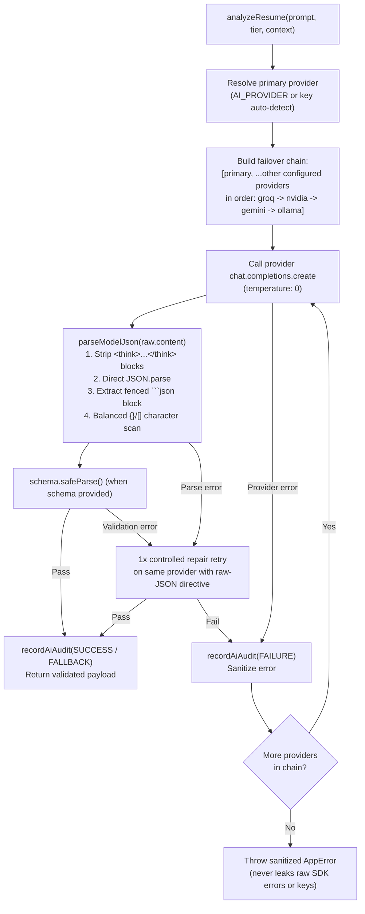

# AI Models, Validation & Telemetry

TrueHire uses a single OpenAI-compatible abstraction (`openai` v7) across four interchangeable LLM providers. All AI orchestration lives in `server/src/integrations/ai/`.

---

## Supported Providers & Model Defaults

| Provider | Client Module | Configured When | Default Base URL | Default Model(s) |
| --- | --- | --- | --- | --- |
| **Groq** (`groq`) | `groqClient.ts` | `GROQ_API_KEY` or `AI_API_KEY` | `https://api.groq.com/openai/v1` | `default`: `qwen/qwen3.8-27b` `fast`: `openai/gpt-oss-20b` `evaluation`: `openai/gpt-oss-120b` |
| **NVIDIA NIM** (`nvidia`) | `nvidiaClient.ts` | `NVIDIA_API_KEY` or `AI_API_KEY` | `https://integrate.api.nvidia.com/v1` | `NVIDIA_MODEL` (`meta/llama-3.3-70b-instruct` in `env.ts` / `render.yaml`; client fallback `nvidia/nemotron-3.5-super-vl-120b-a12b`) |
| **Google Gemini** (`gemini`) | `geminiClient.ts` | `GEMINI_API_KEY` or `AI_API_KEY` | `https://generativelanguage.googleapis.com/v1beta/openai/` | `gemini-flash-latest` (`GEMINI_MODEL`) |
| **Ollama** (`ollama`) | `ollamaClient.ts` | `OLLAMA_BASE_URL` set or `AI_PROVIDER=ollama` | `http://localhost:11434/v1` | `qwen3:4b` (`OLLAMA_MODEL`) |

### Task Tier Routing (Groq)

Groq supports three task tiers (`GroqTaskTier = "default" | "fast" | "evaluation"`):

| Feature (`AiFeatureName`) | Caller | Tier |
| --- | --- | --- |
| `RESUME_ANALYSIS` | `resumeService.ts` | `default` |
| `INTERVIEW_GENERATION` (plan & questions) | `interviewService.ts` | `default` |
| `INTERVIEW_GENERATION` (adaptive follow-up) | `interview.ai.ts` | `fast` |
| `INTERVIEW_ANSWER_EVAL` | `interview.ai.ts` | `default` |
| `INTERVIEW_FINAL_EVAL` | `interviewService.ts` | `evaluation` |

Within `callGroqCompletion()`, non-test calls automatically try `[primaryModel, GROQ_FAST_MODEL]` unless the error is a rate limit (`AI_RATE_LIMITED`) or missing key (`AI_NOT_CONFIGURED`).

---

## Multi-Provider Failover & JSON Repair

Every AI call flows through `analyzeResume(prompt, tier, context)` in `server/src/integrations/ai/aiClient.ts`:

### Key Reliability Safeguards

1. **Resilient JSON Extraction (`server/src/utils/parseModelJson.ts`):** Reasoning models (Qwen, Nemotron, DeepSeek-style) frequently wrap JSON in `<think>...</think>` blocks or Markdown fences. `parseModelJson()` strips reasoning tags, extracts fenced blocks, and falls back to a string-aware balanced bracket scanner before throwing.
2. **Strict Zod Validation:** All AI payloads are validated against Zod schemas before persisting to PostgreSQL:
   - `resumeAnalysisSchema` (`server/src/integrations/ai/resumeSchema.ts`) — retried up to 2 attempts in `analyzeResumeText()` on `AI_INVALID_OUTPUT`.
   - `InterviewPlanSchema`, `InterviewQuestionsSchema`, `QuestionEvaluationSchema` (`server/src/modules/interview/interviewSchema.ts`).
   - `FinalEvaluationSchema` (`server/src/modules/evaluation/finalEvaluationSchema.ts`) — validates overall `score`, `feedback`, 5-dimension `breakdown` (`communication`, `technicalKnowledge`, `problemSolving`, `relevance`, `confidence`), `strengths[]`, `improvements[]`, and `recommendation`.
3. **Crash-Safe Interview Persistence:** `submitAnswerService()` writes the candidate's raw answer to `interview_questions` before invoking `evaluateQuestionAnswer()`. If the AI provider fails, the raw answer remains saved and can be retried; adaptive follow-up failures fall back to deterministic templates in `interview.ai.ts`.
4. **Error Sanitization (`sanitizeProviderError` in `aiTelemetry.ts`):** Raw upstream errors, HTTP bodies, and stack traces are never sent to clients. They are mapped to consistent `AppError` responses:
   - `429 AI_RATE_LIMITED`
   - `504 AI_TIMEOUT`
   - `502 AI_INVALID_OUTPUT`
   - `503 AI_UNAVAILABLE` / `503 AI_NOT_CONFIGURED`

---

## Telemetry & `AiRequestAudit`

`recordAiAudit()` in `server/src/integrations/ai/aiTelemetry.ts` records every AI invocation in two places:

1. **In-memory ring buffer** (last 250 entries, bounded per-user map of 500 users, per-feature counters) — exposed directly in `GET /api/health` under `aiReliability`.
2. **PostgreSQL `ai_request_audits` table (`AiRequestAudit` model)** — non-blocking async insert when `NODE_ENV !== "test"` so telemetry write failures never block user requests.

Tracked fields:
- `userId`, `feature`, `provider`, `model`
- `status`: `SUCCESS`, `FALLBACK` (succeeded on a secondary provider), or `FAILED`
- `latencyMs`, `inputTokens`, `outputTokens`, `errorCode`
- `costUsd`: estimated using `MODEL_COST_PER_1M` blended rates per 1M input/output tokens (`qwen3:4b` is `$0`, unknown models default to `$0.25/$0.50` per 1M tokens).

Admins inspect aggregated reliability, fallback rates, latency percentiles, and estimated spend in `/admin` (`GET /api/admin/ai-reliability`).

---

## Deterministic E2E Mock Mode

Setting `AI_E2E_MOCK=true` in non-production environments short-circuits `analyzeResume()` to `runDeterministicE2eMock()` in `aiClient.ts`. It returns schema-valid fixtures for resume analysis, interview generation, answer evaluation (with trigger tokens like `E2E_VAGUE`, `E2E_BUZZWORD`, `E2E_FAIL`, `E2E_WEAK_SESSION`, `E2E_FORCE_AI_ERROR`), and final evaluation. This mode is hard-disabled whenever `NODE_ENV=production`.

Related docs: [System Architecture](./architecture.md) · [Local Setup](./setup.md) · [API & Data Model](./api-and-data.md)
