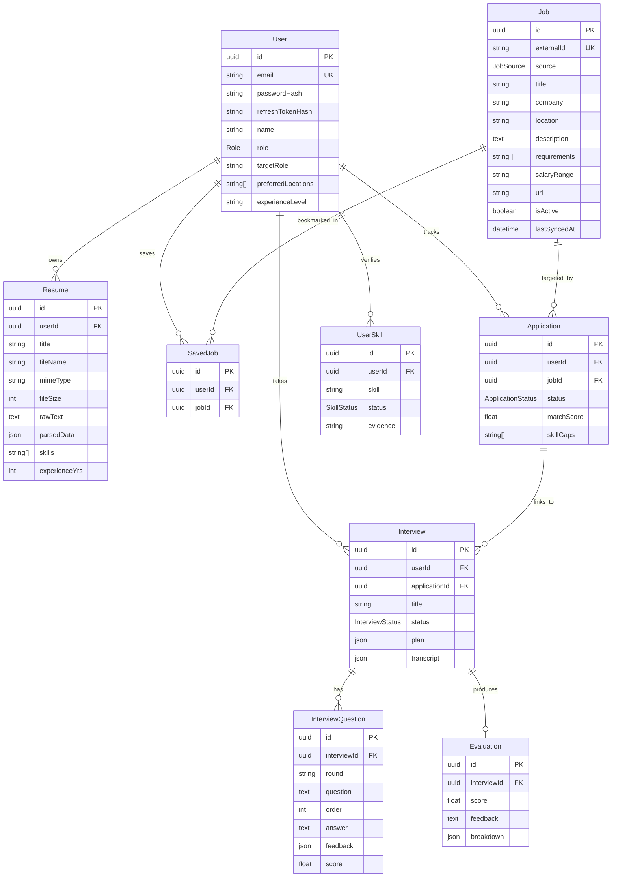

# API Reference & Data Model

All backend routes are mounted under `/api` in `server/src/app.ts` (default local base URL: `http://localhost:5000/api`).

---

## Authentication & Security Model

- **Access & Refresh JWTs (`server/src/utils/jwt.ts`, `server/src/services/authService.ts`):**
  - `POST /api/auth/register` and `POST /api/auth/login` return `{ user, token, refreshToken }`.
  - Access tokens carry `tokenType: "access"` signed with `JWT_SECRET` (default lifetime `7d`). `verifyToken()` explicitly rejects tokens with `tokenType === "refresh"`.
  - Refresh tokens carry `tokenType: "refresh"` and a random `jti`, signed with `JWT_REFRESH_SECRET` (falls back to `JWT_SECRET`). Their SHA-256 hash is persisted in `users.refreshTokenHash` and verified using `crypto.timingSafeEqual`.
  - `POST /api/auth/refresh` rotates both tokens and updates `refreshTokenHash`. If a mismatched refresh token is presented (reuse detection), the active session hash is cleared and the request fails.
  - `POST /api/auth/logout` and password changes in `PUT /api/auth/profile` clear `refreshTokenHash`, revoking the session.
- **Bearer Header:** Protected endpoints require `Authorization: Bearer <accessToken>`.
- **Client Token Storage Note:** The SPA (`client/src/lib/api-client.ts`) currently stores `truehire_auth_token` and `truehire_refresh_token` in `localStorage` and retries once on HTTP `401` via a deduplicated refresh call.
- **Rate Limiting (`server/src/middleware/rateLimit.ts`):**
  - Global (`/api`): 300 req / 15 min
  - Auth (`/api/auth/register`, `/login`, `/refresh`): 10 req / 15 min
  - Uploads (`/api/resumes`, `/paste`, `/:id/reanalyze`): 30 req / 15 min
  - AI interviews (`POST /api/interviews`, `/:id/questions/:qId/answer`, `/:id/evaluation`): 20 req / 1 min
  - Admin (`/api/admin/*`): 60 req / 1 min
- **Standard Error Shape (`server/src/app.ts`):**

```json
{
  "success": false,
  "code": "ERROR_CODE",
  "message": "Human-readable explanation",
  "error": "Human-readable explanation"
}
```

---

## REST Endpoints

### Health (`server/src/app.ts`)

| Method | Path | Auth | Notes |
| --- | --- | --- | --- |
| `GET` | `/api/health` | Public | Runs `SELECT 1` against PostgreSQL. Returns `200` (`status: "ok"`, `database: "connected"`, `aiConfigured`, `aiReliability`) or `503` (`status: "degraded"`). |

### Authentication (`server/src/routes/auth.ts`)

| Method | Path | Auth / Limit | Request Body | Response |
| --- | --- | --- | --- | --- |
| `POST` | `/api/auth/register` | Public · `authLimiter` | `{ email, password, name }` | `201 { user, token, refreshToken }` |
| `POST` | `/api/auth/login` | Public · `authLimiter` | `{ email, password }` | `200 { user, token, refreshToken }` |
| `POST` | `/api/auth/refresh` | Public · `authLimiter` | `{ refreshToken }` | `200 { user, token, refreshToken }` (rotated) |
| `POST` | `/api/auth/logout` | Bearer | — | `200 { message }` (revokes `refreshTokenHash`) |
| `GET` | `/api/auth/me` | Bearer | — | `200 User` |
| `PUT` | `/api/auth/profile` | Bearer | `{ name?, email?, password?, targetRole?, preferredLocations?, experienceLevel? }` | `200 User` |

### Resumes & Tailoring (`server/src/routes/resumeRoutes.ts`)

| Method | Path | Auth / Limit | Request Body | Response |
| --- | --- | --- | --- | --- |
| `POST` | `/api/resumes` | Bearer · `uploadLimiter` | `multipart/form-data` field `resume` (PDF or DOCX, <= 5 MB) | `201 { success, message, resume }` |
| `POST` | `/api/resumes/paste` | Bearer · `uploadLimiter` | `{ title?, rawText }` | `201 { success, message, resume }` |
| `GET` | `/api/resumes` | Bearer | — | `200 { success, resumes }` (newest first, user-scoped) |
| `GET` | `/api/resumes/:id` | Bearer | — | `200 { success, resume }` |
| `POST` | `/api/resumes/:id/reanalyze` | Bearer · `uploadLimiter` | `{ rawText? }` | `200 { success, message, resume }` |
| `PATCH` | `/api/resumes/:id/sections` | Bearer | Partial parsed sections / `skills` / `title` | `200 { success, message, resume }` |
| `DELETE` | `/api/resumes/:id` | Bearer | — | `200 { success, message }` |
| `POST` | `/api/resumes/:id/tailoring` | Bearer | `{ jobId }` | `200 { success, data: TailoringSuggestions }` (deterministic, no LLM) |
| `POST` | `/api/resumes/:id/tailoring/apply` | Bearer | `{ acceptedSkills?: string[], acceptedBullets?: array }` | `200 { success, message, data }` |

### Jobs & Saved Roles (`server/src/routes/jobRoutes.ts`)

| Method | Path | Auth | Query / Body | Response |
| --- | --- | --- | --- | --- |
| `GET` | `/api/jobs` | Bearer | Query: `q`, `location`, `source` (`GREENHOUSE`\|`LEVER`\|`ASHBY`\|`MANUAL`\|`LINKEDIN`), `page` (default `1`), `pageSize` (default `50`, max `100`) | `200` active jobs list & pagination metadata |
| `GET` | `/api/jobs/saved` | Bearer | — | `200` user's saved jobs |
| `GET` | `/api/jobs/:id` | Bearer | — | `200 { success, job }` |
| `POST` | `/api/jobs/external` | Bearer | `{ title, company, description, location?, source?, url?, salaryRange? }` (`url` must be `http:`/`https:`) | `201` imported job with extracted `requirements[]` |
| `POST` | `/api/jobs/:id/save` | Bearer | — | `201` saved bookmark |
| `DELETE` | `/api/jobs/:id/save` | Bearer | — | `200` removal confirmation |
| `POST` | `/api/jobs/sync` | Bearer + `ADMIN` | Optional `{ boardToken?, company? }` | `200` multi-board or single-board sync summary |
| `POST` | `/api/jobs/sync/greenhouse` | Bearer + `ADMIN` | Optional `{ boardToken?, company? }` | `200` alias of `/api/jobs/sync` |

### Matching & Role-Fit Radar (`server/src/routes/matchRoutes.ts`, `radarRoutes.ts`)

| Method | Path | Auth | Query / Body | Response |
| --- | --- | --- | --- | --- |
| `POST` | `/api/matches` | Bearer | `{ resumeId, jobId }` | `200 { success, data }` deterministic match score, `INSUFFICIENT_DATA` status, gaps, tactical matrix, evidence audit; upserts `Application` |
| `POST` | `/api/matches/simulate` | Bearer | `{ resumeId, jobId, selectedSkills: string[] }` | `200 { success, data }` simulated score delta & unlocked requirements |
| `GET` | `/api/radar` | Bearer | Optional `?resumeId=<uuid>` | `200 { success, data }` 5 strategic job-fit buckets (`topBestFit`, `oneSkillBreakouts`, `evidenceShifted`, `needsValidation`, `deprioritized`) |

### Applications (`server/src/routes/applicationRoutes.ts`)

| Method | Path | Auth | Body | Response |
| --- | --- | --- | --- | --- |
| `GET` | `/api/applications` | Bearer | — | `200` user applications with nested `job` and `interviews` |
| `GET` | `/api/applications/:id` | Bearer | — | `200` single user-scoped application |
| `POST` | `/api/applications/job/:jobId` | Bearer | — | `201` application (unique per `userId, jobId`) |
| `PATCH` | `/api/applications/:id/status` | Bearer | `{ status: "SAVED" \| "APPLIED" \| "INTERVIEWING" \| "OFFER" \| "REJECTED" }` | `200` updated application |
| `DELETE` | `/api/applications/:id` | Bearer | — | `200` deletion confirmation |

### Mock Interviews (`server/src/routes/interviewRoutes.ts`)

| Method | Path | Auth / Limit | Body | Response |
| --- | --- | --- | --- | --- |
| `GET` | `/api/interviews` | Bearer | — | `200 { success, data: Interview[] }` |
| `POST` | `/api/interviews` | Bearer · `aiLimiter` | `{ applicationId, durationMinutes?, difficulty?, focusTopics?, selectedRounds? }` | `201 { success, message, data: Interview }` (with generated `questions[]`) |
| `GET` | `/api/interviews/:interviewId` | Bearer | — | `200 { success, message, data: Interview }` (with `questions`, `evaluation`, `transcript`) |
| `POST` | `/api/interviews/:interviewId/start` | Bearer | — | `200 { success, message, data: { interview, firstQuestion } }` (`SCHEDULED` -> `IN_PROGRESS`) |
| `POST` | `/api/interviews/:interviewId/questions/:questionId/answer` | Bearer · `aiLimiter` | `{ answer: string }` | `200 { success, message, data: { evaluation, updatedQuestion, nextQuestion, completed, adaptiveFollowUp } }` (`409` if already scored; raw answer persisted first so AI errors return retryable `503`) |
| `POST` | `/api/interviews/:interviewId/evaluation` | Bearer · `aiLimiter` | — | `201 { success, message, data: { evaluation } }` (requires `COMPLETED`; `409` if already evaluated; transactionally upserts `UserSkill` evidence and saves structured `transcript`) |

### Readiness & Skill Ontology (`server/src/routes/readinessRoutes.ts`, `ontologyRoutes.ts`)

| Method | Path | Auth | Body | Response |
| --- | --- | --- | --- | --- |
| `GET` | `/api/readiness` | Bearer | — | `200 { success, data }` skills ledger, `nextAction`, `defenseSummary`, `offenseTargets`, `interviewHistoryBySkill`, `matchImprovement` |
| `POST` | `/api/readiness/proof` | Bearer | `{ skill, proofType ("GITHUB_LINK"\|"PROJECT_DESCRIPTION"\|"CERTIFICATION"\|"RESUME_BULLET"), title?, url?, description, jobId?, resumeId?, syncToResume? }` | `200 { success, message, data: { skillRecord, readiness, updatedMatch } }` |
| `GET` | `/api/ontology/dashboard` | Bearer | — | `200 { success, data }` canonical stats, family breakdown, false-positive audit, extraction benchmark, `insufficientDataJobs`, `reviewQueue` (resume scan scoped to current user unless `ADMIN`) |
| `POST` | `/api/ontology/review-queue/resolve` | Bearer + `ADMIN` | `{ token, action ("APPROVE_CANONICAL"\|"MAP_ALIAS"\|"DISMISS"), targetCanonical?, family? }` | `200 { success, data }` persisted to `ontology_aliases` |

### Admin Operations (`server/src/routes/adminRoutes.ts`)

All routes require `authMiddleware`, `requireRole("ADMIN")`, and `adminLimiter`.

| Method | Path | Description |
| --- | --- | --- |
| `GET` | `/api/admin/overview` | System overview across users, jobs, resumes, AI, and interviews (`?rangeDays=1\|7\|30\|ALL`). |
| `GET` | `/api/admin/job-syncs` | Recent `JobSyncAudit` logs, board health, and failure counts. |
| `GET` | `/api/admin/ai-reliability` | Provider latency, fallback ratio, token counts, and estimated cost from `AiRequestAudit`. |
| `GET` | `/api/admin/resume-quality` | Parse success/failure rates and quality scores from `ResumeParseAudit`. |
| `GET` | `/api/admin/matching-quality` | Ontology coverage, `INSUFFICIENT_DATA` ratio, and pending review queue tokens. |
| `GET` | `/api/admin/closed-loop` | Funnel conversion metrics from `FeatureUsageEvent`. |
| `POST` | `/api/admin/job-syncs/run` | Manually triggers a multi-board ATS job sync. |
| `POST` | `/api/admin/ontology/review-queue/resolve` | Resolves an unrecognized ontology token from the Admin Console. |

---

## Prisma Data Model (`server/prisma/schema.prisma`)

PostgreSQL 15 schema managed with Prisma (`url = env("DATABASE_URL")`, `directUrl = env("DIRECT_URL")`). There are **5 enums** and **14 models** across 7 migrations in `server/prisma/migrations/`.

### Enums

- `Role`: `USER`, `ADMIN`
- `JobSource`: `GREENHOUSE`, `LEVER`, `ASHBY`, `MANUAL`, `LINKEDIN`
- `ApplicationStatus`: `SAVED`, `APPLIED`, `INTERVIEWING`, `OFFER`, `REJECTED`
- `InterviewStatus`: `SCHEDULED`, `IN_PROGRESS`, `COMPLETED`, `CANCELLED`
- `SkillStatus`: `STRONG`, `WEAK`

### Core Relational Models (9)



Key constraints:
- `SavedJob`: `@@unique([userId, jobId])`
- `Application`: `@@unique([userId, jobId])`
- `InterviewQuestion`: `@@unique([interviewId, order])`
- `Evaluation`: `interviewId @unique`
- `UserSkill`: `@@unique([userId, skill])`

### Ontology & Observability Models (5)

| Model | Table (`@@map`) | Key Columns | Purpose |
| --- | --- | --- | --- |
| `OntologyAlias` | `ontology_aliases` | `rawSkill`, `canonicalSkill`, `status` (`APPROVED`\|`REJECTED`\|`PENDING`), `createdBy` | Admin-managed skill aliases hydrated into memory on server startup (`hydrateOntologyFromDatabase()`). |
| `AiRequestAudit` | `ai_request_audits` | `userId`, `feature`, `provider`, `model`, `status` (`SUCCESS`\|`FAILED`\|`FALLBACK`), `latencyMs`, `inputTokens`, `outputTokens`, `costUsd`, `errorCode` | Durable log of every AI request across providers and fallbacks. |
| `JobSyncAudit` | `job_sync_audits` | `source`, `boardToken`, `status` (`SUCCESS`\|`PARTIAL`\|`FAILED`), `jobsFetched`, `jobsCreated`, `jobsUpdated`, `jobsDeactivated`, `duplicatesFound`, `durationMs`, `errorMessage` | ATS board sync telemetry for `/admin`. |
| `ResumeParseAudit` | `resume_parse_audits` | `userId`, `resumeId`, `mimeType`, `status` (`SUCCESS`\|`FAILED`\|`LOW_QUALITY`), `qualityScore`, `textLength`, `warnings`, `durationMs` | Extraction health and low-quality parse diagnostics. |
| `FeatureUsageEvent` | `feature_usage_events` | `userId`, `event`, `metadata` | Closed-loop product milestones (`resume_uploaded`, `interview_created`, `interview_completed`, `evaluation_generated`, `skill_proof_submitted`, etc.). |

Related docs: [System Architecture](./architecture.md) · [AI Models & Telemetry](./ai-models.md) · [Local Setup](./setup.md)
