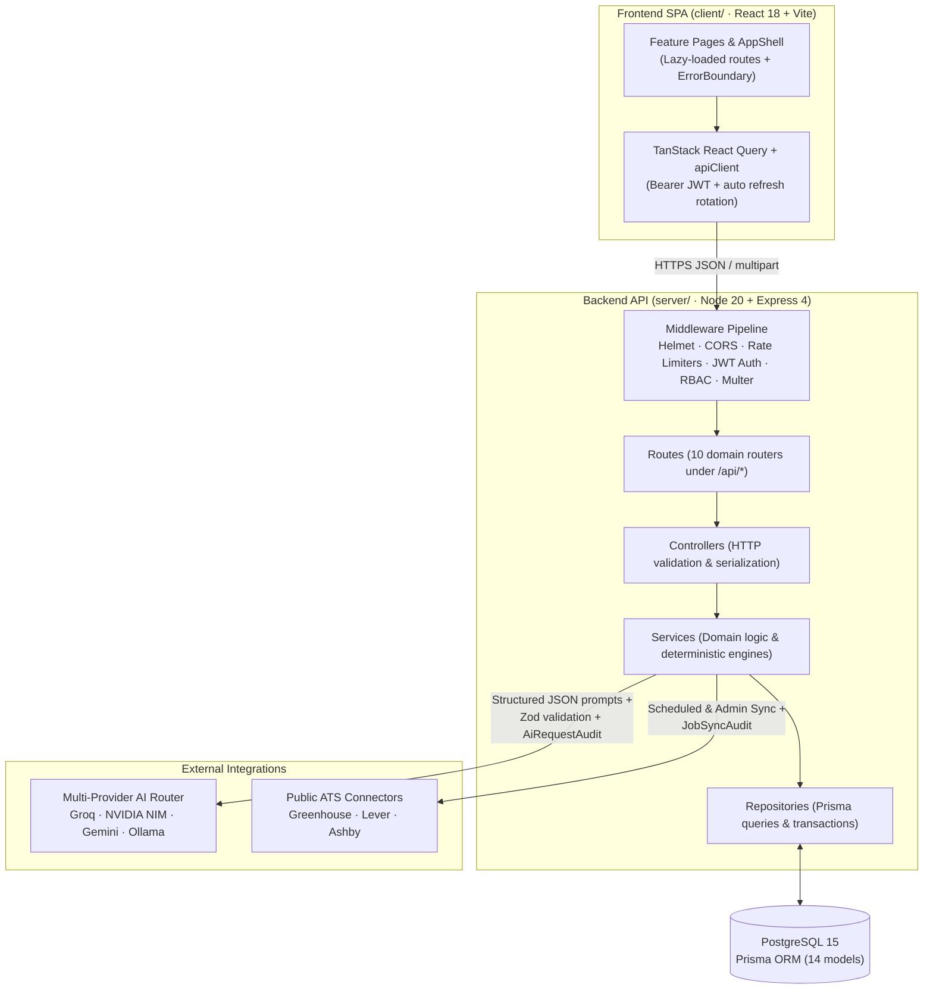
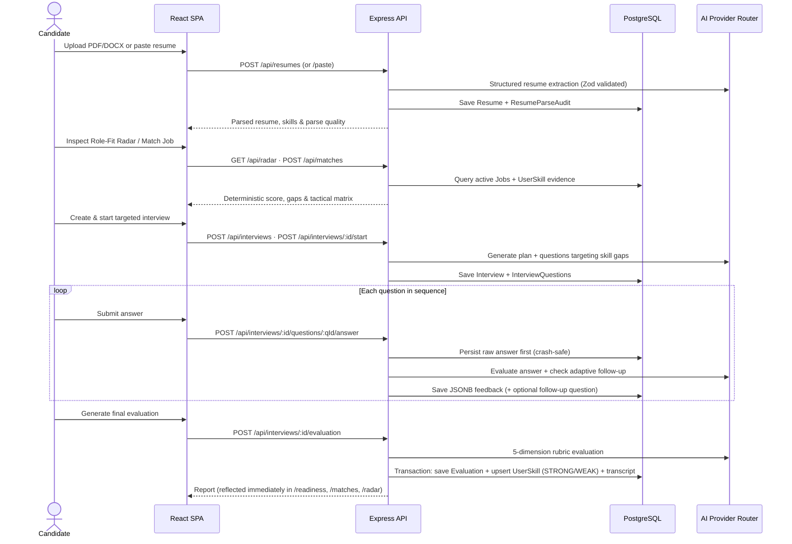
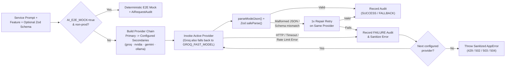

# System Architecture

TrueHire (`career-lens-monorepo`) is a full-stack TypeScript monorepo consisting of a React SPA (`client/`) and an Express REST API (`server/`) backed by PostgreSQL 15 via Prisma ORM.

---

## High-Level System Architecture



---

## Layered Backend Architecture (`server/src/`)

Every HTTP request follows a strict one-way layering discipline so transport concerns stay separate from domain logic and SQL persistence:

```text
routes -> controllers -> services -> repositories -> prisma
```

| Layer | Directory | Responsibility |
| --- | --- | --- |
| **App & Config** | `src/app.ts`, `src/index.ts`, `src/config/` | Express setup (`trust proxy`, Helmet, CORS allowlist, centralized `AppError`/Zod/Multer error handler), Zod env validation (`env.ts`), Prisma singleton (`db.ts`), optional Sentry hooks (`sentry.ts`), ontology DB hydration, and background job sync scheduler. |
| **Middleware** | `src/middleware/` | `authMiddleware.ts` (JWT verification rejecting refresh tokens), `requireRole.ts` (`ADMIN` guard), `rateLimit.ts` (5 tiers: global, auth, upload, AI, admin), `uploadMiddleware.ts` (Multer in-memory 5 MB PDF/DOCX filter on field `resume`). |
| **Routes** | `src/routes/` | 10 Express routers mounted in `app.ts`: `admin`, `auth`, `resumes`, `jobs`, `matches`, `interviews`, `applications`, `readiness`, `ontology`, `radar`. |
| **Controllers** | `src/controllers/` | Parse params/body, enforce request-level input checks, invoke services, and format JSON responses. |
| **Services** | `src/services/` | Core business rules: resume extraction/quality scoring, deterministic skill ontology & matching (`matching/`), Role-Fit Radar, evidence-bounded tailoring (`tailoring/`), interview orchestration & adaptive follow-ups, readiness rule engine (`readiness/`), skill evidence mapping (`skills/`), ATS sync (`greenhouseSyncService.ts`), admin analytics (`admin/`), and telemetry (`telemetry/`). |
| **Repositories** | `src/repositories/` | 8 Prisma data-access modules (`application`, `interview`, `job`, `match`, `resume`, `savedJob`, `skill`, `user`), enforcing user-scoped queries and atomic transactions (e.g., `saveEvaluationWithSkillEvidence`). |
| **Integrations** | `src/integrations/` | Multi-provider OpenAI-compatible AI router (`ai/`) and ATS board clients/adapters/Zod schemas (`jobs/greenhouse/`, `jobs/lever/`, `jobs/ashby/`). |
| **Modules** | `src/modules/` | Prompt builders, adaptive interviewer helpers, and Zod output schemas for interview plans, questions, per-question evaluations (`interview/`), and final rubric reports (`evaluation/`). |

### Deterministic vs. AI Boundaries

TrueHire intentionally keeps critical scoring paths deterministic and reserves LLMs for unstructured extraction and open-ended interview reasoning:

- **Deterministic (zero LLM calls):**
  - Skill extraction & normalization (`skillDictionary.ts`, `skillNormalizer.ts`, `jobSkillExtractor.ts` — 340+ canonical skills across 9 families with whole-word boundary matching)
  - Resume-to-job match scoring, skill gap prioritization, offense/defense tactical matrix, and what-if simulation (`matchingService.ts`, `matchService.ts`)
  - Role-Fit Radar 5-bucket classification (`roleFitRadarService.ts`)
  - Evidence-bounded resume tailoring (`tailoringService.ts`)
  - Readiness defensibility scoring and next-action rule engine (`readinessService.ts`, `nextAction.ts`)
  - Interview report-to-`UserSkill` evidence mapping (`skillEvidence.ts`)
- **AI-assisted (Zod-validated + audited):**
  - Resume structure extraction (`RESUME_ANALYSIS`)
  - Default interview plan generation & question generation (`INTERVIEW_GENERATION`)
  - Per-question answer evaluation (`INTERVIEW_ANSWER_EVAL`) and adaptive follow-up generation (with deterministic template fallback)
  - Final 5-dimension rubric evaluation (`INTERVIEW_FINAL_EVAL`)

---

## Frontend Architecture (`client/src/`)

The client is a Vite + React 18 SPA organized by product domain (`src/features/`), with route-level `React.lazy` code splitting and manual Rollup vendor chunks (`react-vendor`, `query-vendor`, `motion-vendor`, `icons-vendor`, `sentry-vendor`) in `client/vite.config.ts`.

```text
client/src/
├── App.tsx                  # Route definitions, ProtectedRoute, AdminRoute, lazy imports
├── components/
│   ├── ErrorBoundary.tsx    # Top-level crash recovery
│   ├── layout/              # AppShell (workspace/auth/minimal), Sidebar, TopNav, MobileNav, CommandPalette (Cmd/Ctrl+K)
│   └── ui/                  # Shared primitives, Charts, ThemeToggle, MotionPrimitives, SmoothScrollProvider
├── context/                 # ThemeContext, ToastContext
├── features/
│   ├── admin/               # Admin Operations Console (/admin)
│   ├── auth/                # AuthContext, Login/Register, OnboardingWizard, Profile
│   ├── dashboard/           # Candidate readiness overview (/dashboard)
│   ├── interview/           # List, Prep, Live Interview, Evaluation + Markdown export (/interviews/*)
│   ├── jobs/                # ATS job explorer & saved jobs (/jobs, /saved-jobs)
│   ├── landing/             # Public landing page (/)
│   ├── matching/            # Match breakdown & skill-gap what-if simulator (/matches/:jobId, /skill-gaps/:jobId)
│   ├── ontology/            # Ontology coverage, audits & admin review queue (/ontology)
│   ├── radar/               # Role-Fit Radar 5-bucket view (/radar)
│   ├── readiness/           # Skill ledger & proof submission (/readiness, /skills)
│   ├── resume/              # File upload, paste, parsed preview & inline section editor (/resume)
│   ├── tailoring/           # Evidence-bounded tailoring workbench (/tailor/:jobId)
│   └── tracker/             # Application pipeline tracker (/applications)
├── lib/                     # api-client.ts, sanitize.ts, chartMath.ts, theme.ts, toast.ts, sentry.ts
└── services/                # authApi.ts
```

### Client Security & Resilience

- **Token lifecycle (`client/src/lib/api-client.ts`):** Injects `Authorization: Bearer <token>`, deduplicates concurrent 401 refresh calls via a shared `refreshPromise`, retries once with the rotated access token, and clears storage + dispatches `truehire:unauthorized` on refresh failure.
- **Untrusted content sanitization (`client/src/lib/sanitize.ts`):** External job HTML is filtered through an allowlist sanitizer before rendering, and external links are validated against `http:`/`https:`.

---

## Closed-Loop Sequence Flow



---

## AI Provider Fallback Flow

All AI calls pass through `analyzeResume()` in `server/src/integrations/ai/aiClient.ts`:



See [AI Models & Telemetry](./ai-models.md) for provider model tiers, JSON parsing rules, and cost tracking, and [API & Data Model](./api-and-data.md) for endpoint contracts and Prisma models.
